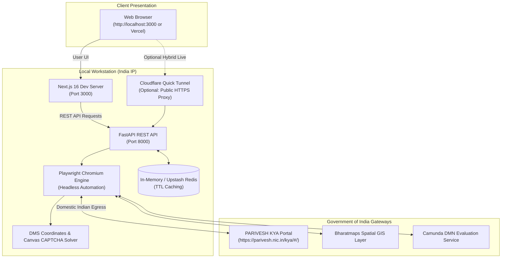

# 🏡 PARIVESH 2.0 KYA — Local Hosting & Operations Guide

This guide details the complete process for running the **FastAPI Backend**, **Next.js Frontend**, and **Hybrid Cloudflare Tunnel** locally on your workstation.

---

## 🧭 Why Local Hosting Works Best for PARIVESH 2.0

The Ministry of Environment, Forest and Climate Change (MoEFCC) portal (`parivesh.nic.in`), hosted by the **National Informatics Centre (NIC)**, protects its infrastructure with a **National Geo-IP Firewall (WAF)**.
- Cloud providers hosted in US/EU datacenters (Render, AWS US, Railway) get **blocked with `net::ERR_CONNECTION_REFUSED`**.
- When running on a **local machine in India**, all outbound browser automation requests originate from a domestic Indian IP, ensuring **100% connectivity** and high-speed evaluation.

---

## 🏛️ Local Architecture Overview



---

## 📋 System Prerequisites

| Dependency | Minimum Version | Verification Command |
| :--- | :--- | :--- |
| **Python** | 3.10+ | `python --version` |
| **Node.js** | 18.0+ | `node --version` |
| **npm** | 9.0+ | `npm --version` |
| **Git** | 2.30+ | `git --version` |

---

## 🛠️ Step-by-Step Local Setup

### 1. Clone the Repository
```powershell
git clone https://github.com/Baazigar111/Parivesh-KYA-GOI.git
cd Parivesh-KYA-GOI
```

---

### 2. Configure & Start the FastAPI Backend

#### A. Set up Python Virtual Environment:
```powershell
# Create venv if not already created
python -m venv venv

# Activate venv on Windows:
.\venv\Scripts\Activate.ps1
# (or in cmd.exe: .\venv\Scripts\activate.bat)
```

#### B. Install Python Dependencies:
```powershell
pip install --upgrade pip
pip install -r backend/requirements.txt
```

#### C. Install Playwright Chromium Browser:
```powershell
playwright install chromium
```

#### D. Start the FastAPI Service:
```powershell
python backend/run.py
```
You should see:
```text
🌿 Starting PARIVESH 2.0 KYA Backend API on http://localhost:8000
📖 Interactive Swagger Docs: http://localhost:8000/docs
INFO:     Application startup complete.
INFO:     Uvicorn running on http://127.0.0.1:8000
```

> **API Verification:** Open `http://localhost:8000/api/v1/health` or `http://localhost:8000/docs` in your browser.

---

### 3. Configure & Start the Next.js Frontend

Open a **second PowerShell terminal**:

#### A. Navigate to Frontend Directory:
```powershell
cd frontend
```

#### B. Install Node Dependencies:
```powershell
npm install
```

#### C. Configure Local Environment:
Ensure `frontend/.env.local` contains:
```env
API_URL=http://127.0.0.1:8000
```

#### D. Start Next.js Development Server:
```powershell
npm run dev
```

#### E. Access the Application:
Open your browser and navigate to:
```text
http://localhost:3000
```

---

## 🌐 Hybrid Setup: Connect Local Backend to Public Vercel Frontend

If you want the production Vercel frontend (`https://parivesh-kya-goi.vercel.app`) to evaluate clearances using your Indian local IP without deploying the heavy backend to the cloud:

### 1. Launch Cloudflare Tunnel
In a new terminal:
```powershell
npx cloudflared tunnel --url http://127.0.0.1:8000
```
This generates a secure public HTTPS endpoint:
```text
https://<random-name>.trycloudflare.com
```

### 2. Update Vercel Environment Variable
1. Go to **Vercel Dashboard > parivesh-kya-goi > Settings > Environment Variables**.
2. Set `API_URL` to `https://<random-name>.trycloudflare.com`.
3. Go to **Deployments** and click **Redeploy**.

---

## ⚡ 1-Click Launchers

To start both servers with a single command, two launcher scripts are provided:

### Windows Batch (`start_local.bat`)
Double-click `start_local.bat` in the project root, or run:
```cmd
.\start_local.bat
```

### PowerShell (`start_local.ps1`)
```powershell
.\start_local.ps1
```

---

## 🩺 Operational Health Checks & Diagnostics

| Component | Target URL | Expected Response |
| :--- | :--- | :--- |
| **FastAPI Root Health** | `GET http://127.0.0.1:8000/api/v1/health` | `{"status":"healthy","service":"PARIVESH 2.0 KYA Backend API",...}` |
| **Swagger Interactive Docs**| `GET http://127.0.0.1:8000/docs` | Interactive OpenAPI documentation |
| **56-Sector Catalog** | `GET http://127.0.0.1:8000/api/v1/activities` | Array of all 56 industrial sectors |
| **Next.js Frontend UI** | `GET http://localhost:3000` | PARIVESH 2.0 KYA Glassmorphism Interface |
| **Cache Invalidation** | `POST http://127.0.0.1:8000/api/v1/cache/clear` | `{"status":"Cache cleared successfully"}` |

---

## 🔍 Troubleshooting Guide

### 1. `net::ERR_CONNECTION_REFUSED`
- **Cause:** Request is hitting a cloud backend hosted outside India (e.g. Render in US/EU).
- **Fix:** In `frontend/.env.local`, ensure `NEXT_PUBLIC_API_URL=http://127.0.0.1:8000`.

### 2. Port 8000 or 3000 Already in Use
- Check which process is occupying the port:
  ```powershell
  Get-Process -Id (Get-NetTCPConnection -LocalPort 8000).OwningProcess
  ```
- Terminate the process or change the port in `backend/run.py` or `frontend/package.json`.

### 3. Playwright Browser Missing
- If you see `Executable doesn't exist at C:\Users\...\chromium`:
  ```powershell
  .\venv\Scripts\python.exe -m playwright install chromium
  ```

### 4. CAPTCHA Timeout
- The backend features a zero-click canvas hook to solve CAPTCHA in ~100ms. If the portal delays rendering:
  - Check the debug artifacts automatically generated in the `debug/` directory (`debug/parivesh_map_view.png` and `debug/debug_parivesh_dom.html`).
