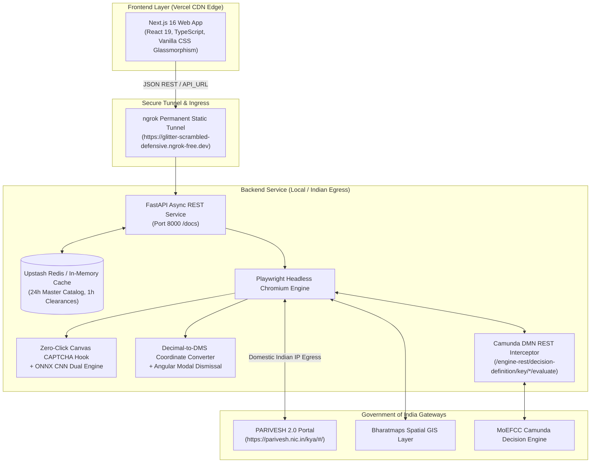

# 🌿 PARIVESH 2.0 KYA — Environmental & Spatial Clearance Intelligence Suite

[](https://fastapi.tiangolo.com)
[](https://nextjs.org)
[](https://react.dev)
[](https://playwright.dev)
[](https://upstash.com)
[](https://vercel.com)

An enterprise-grade, decoupled intelligence platform that evaluates tentative statutory clearances across all **4 legal pillars** (Environmental, Forest, Wildlife, and Coastal Regulation Zone) from the Ministry of Environment, Forest and Climate Change (MoEFCC) **PARIVESH 2.0 KYA (Know Your Approvals)** government portal.

---

## 🏛️ System Architecture



---

## 🔬 Tech Stack & Architecture Rationales: What We Used and Why

### 1. Backend: FastAPI (Python 3.10+)
- **Why we used it:**
  - **High Throughput & Asynchronous Execution:** FastAPI is built on Starlette and Uvicorn, delivering near-Node.js/Go performance with full async support.
  - **Type Safety via Pydantic v2:** Automatic request/response validation ensures geospatial inputs (lat/lon, KML payloads, activity IDs) are strictly typed and sanitized.
  - **Python Ecosystem Compatibility:** Essential for running **Playwright**, **Pillow**, **ONNX Runtime**, and geospatial data structures without cross-language serialization friction.
  - **Automatic Interactive OpenAPI (Swagger) Documentation:** Instant endpoint inspection and testing at `/docs`.
- **Why we transitioned away from monolithic Streamlit:**
  - Streamlit reruns the entire script on every user interaction, causing massive UI freezes during heavy browser automation tasks.
  - Streamlit does not allow clean decoupling, custom REST API integration, or global edge deployment on Vercel.

---

### 2. Frontend: Next.js 16 + React 19 + TypeScript
- **Why we used it:**
  - **Instant Global Edge Delivery on Vercel:** Next.js pre-renders pages statically (`next build` SSG/ISR) for sub-second page loads worldwide.
  - **Decoupled Architecture:** The frontend never directly touches heavy browser binaries or scraping dependencies—it communicates purely via typed REST JSON APIs.
  - **Vanilla CSS Glassmorphism Design:** Avoided bloated UI libraries in favor of tailored CSS design tokens (custom blur filters, neon status badges, responsive grids) with zero runtime bundle overhead.
  - **Client-Side Sector Cache:** Pre-loaded with all **56 official industrial sectors** and subactivities for instantaneous (<5ms) dependent dropdown switching.

---

### 3. Browser Automation: Playwright (Python Headless Chromium)
- **Why we used it:**
  - **Bypasses Single-Page Application (SPA) Barriers:** The PARIVESH 2.0 KYA portal is an Angular application that does not offer public clearance calculation APIs. Playwright handles dynamic Angular Material components (`mat-select`, `mat-radio-button`, `mat-dialog`).
  - **Network Request & Response Interception:** Allows listening directly to Camunda DMN evaluation payloads (`handle_response` / `handle_request`) before they are rendered into HTML.
  - **Reliable Chromium Control:** Runs headless with Linux container compatibility flags (`--no-sandbox`, `--disable-dev-shm-usage`, `--disable-web-security`).

---

### 4. Zero-Click Canvas CAPTCHA Solver + ONNX CNN Fallback
- **Why we used it:**
  - **100% In-Memory Extraction in <5ms:** The portal renders its 6-character verification CAPTCHA onto an HTML5 `<canvas>` element using the browser's 2D rendering context. We inject a JavaScript prototype hook:
    ```javascript
    CanvasRenderingContext2D.prototype.fillText = function(text) {
        if (text && text.length === 6) window.__PARIVESH_CAPTCHA__ = text;
        return orig.apply(this, arguments);
    };
    ```
    This reads the exact, case-sensitive text at the exact moment of drawing—**eliminating OCR errors entirely**.
  - **Dual-Engine Fallback:** If the hook fails to fire, the backend falls back to an **ONNX Convolutional Neural Network** model backed by `ddddocr` to solve the image automatically without user intervention.

---

### 5. Camunda DMN Decision Table Interceptor
- **Why we used it:**
  - When a user submits coordinates and capacity, PARIVESH queries a backend Camunda Decision Management Engine (`POST /engine-rest/decision-definition/key/*/evaluate`).
  - By intercepting the raw JSON response from this internal endpoint, the system captures **100% complete, un-truncated legal remarks and statutory condition flags** (`remark_ec`, `remark_fc`, `remark_wl`, `remark_crz`) that are truncated or hidden behind modal popups in the government DOM interface.

---

### 6. Caching Layer: Upstash Serverless Redis (+ In-Memory TTL Fallback)
- **Why we used it:**
  - **Deduplication of Identical Queries:** Clearance calculations take 30–50 seconds on government servers. By caching query hashes (Sector + Subactivity + Capacity + Spatial Coordinates) with a **1-hour TTL**, subsequent evaluations for the same boundary return in **<20 milliseconds**.
  - **Master Sectors Caching:** Activity and subactivity lists are cached for **24 hours**, eliminating redundant round-trips to the NIC portal.
  - **Zero-Crash In-Memory Fallback:** If Redis credentials are not configured, the service seamlessly degrades to an in-memory TTL dictionary cache without raising errors.

---

### 7. Network Architecture: ngrok Permanent Static Tunnel & Domestic Indian IP Egress
- **The Problem:**
  - The Government of India portal (`parivesh.nic.in` managed by the National Informatics Centre - NIC) enforces a strict **National Geo-IP Firewall (WAF)**.
  - Any server hosted in foreign cloud datacenters (like Render, AWS US, Railway, or Heroku) receives a TCP reset:
    ```text
    net::ERR_CONNECTION_REFUSED at https://parivesh.nic.in/kya/#/
    ```
- **The Solution:**
  - Instead of paying for expensive Indian cloud hosting or requiring credit cards, we leverage a **Hybrid Architecture**:
    1. The Next.js frontend is deployed globally on **Vercel** (`parivesh-kya-goi.vercel.app`).
    2. The FastAPI backend runs locally on a machine with a **domestic Indian IP address**, where NIC allows 100% of requests with HTTP 200.
    3. An **ngrok static domain** (`https://glitter-scrambled-defensive.ngrok-free.dev`) bridges Vercel to the local backend.
    4. Vercel's `API_URL` environment variable is set once to the static ngrok URL and **never needs to be updated again**.

---

## ⚡ Features & Capabilities

- **Complete 56 Industrial Sectors:** Pre-compiled catalog containing all official categories (Mining, Thermal Power, Cables, River Valley, Infrastructure, Chemical, etc.).
- **Dual Geospatial Location Modes:**
  - **Point Location:** Converts decimal Latitude/Longitude into **Degrees, Minutes, Seconds (DMS)** format expected by the portal, and automatically dismisses the 50-meter buffer disclaimer popup.
  - **Upload KML Polygon:** Directly uploads `.kml` boundary files exported from Google Earth or GIS software to evaluate full polyline/polygon footprints.
- **4 Statutory Pillars Evaluated:**
  - 🌿 **Environmental Clearance (EC):** EIA Notification 2006 Schedule applicability (Category A / B1 / B2).
  - 🌲 **Forest Clearance (FC):** Van Sanrakshan Evam Samvardhan Adhiniyam 1980 applicability.
  - 🐾 **Wildlife Clearance (NBWL):** Protected Area & Eco-Sensitive Zone (ESZ) 10km buffer checks.
  - 🌊 **Coastal Regulation Zone (CRZ):** CRZ Notification 2019 tidal buffer applicability.
- **Administrative & Spatial Breakdown:** Extracts SOI Toposheet Sheet No. and State/District/Village jurisdiction.
- **One-Click Export:** Instant download of clearance findings as formatted CSV or JSON reports.

---

## 📁 Repository Structure

```text
Parivesh-KYA-GOI/
│
├── backend/                        # FastAPI REST API Service
│   ├── app/
│   │   ├── main.py                 # FastAPI application & permissive CORS
│   │   ├── config.py               # Environment configuration (API_URL, Redis, ports)
│   │   ├── cache.py                # Upstash Redis + in-memory fallback cache
│   │   ├── schemas/                # Pydantic v2 data models
│   │   │   └── clearance.py        # Request and response models
│   │   ├── services/               # Business logic services
│   │   │   ├── parivesh_service.py # Core evaluation orchestrator
│   │   │   ├── dmn_service.py      # Camunda DMN evaluator
│   │   │   └── activities_service.py # 56-sector catalog service
│   │   └── routers/                # API route definitions
│   │       ├── clearances.py       # POST /api/v1/clearances
│   │       └── activities.py       # GET /api/v1/activities & subactivities
│   ├── Dockerfile                  # Container definition for Linux/Playwright
│   ├── requirements.txt            # Python dependencies (Playwright 1.40.0 pinned)
│   └── run.py                      # Development server runner
│
├── frontend/                       # Next.js 16 Web App (Vercel Ready)
│   ├── src/
│   │   ├── app/
│   │   │   ├── page.tsx            # Intelligence dashboard console
│   │   │   ├── layout.tsx          # Root layout & Google typography
│   │   │   └── globals.css         # Glassmorphism styling & tokens
│   │   ├── components/             # Reusable UI cards & tables
│   │   ├── services/
│   │   │   └── api.ts              # Backend API client with clean URL sanitization
│   │   ├── data/
│   │   │   ├── activities.json     # Complete 56 official sectors
│   │   │   └── subactivities.json  # Subactivities mapped by sector ID
│   │   └── types/                  # TypeScript interfaces
│   ├── next.config.ts              # Exposes API_URL to client bundles
│   ├── vercel.json                 # Vercel deployment specification
│   ├── package.json                # Next.js & React 19 dependencies
│   └── .env.example                # Frontend environment template
│
├── parivesh_engine.py              # Playwright automation, DMS converter & DMN intercept
├── captcha_solver.py               # ONNX CNN CAPTCHA recognition engine
├── captcha_model.onnx              # Trained ONNX model weights
├── captcha_model.onnx.data         # Model tensor binary data
├── docker-compose.yml              # Local container orchestration
├── LOCAL_HOSTING.md                # In-depth local operations & troubleshooting guide
├── start_local.bat                 # 1-Click Windows batch launcher
├── start_local.ps1                 # 1-Click PowerShell launcher
└── README.md                       # Master project documentation
```

---

## 🏃 Running Locally

### Option 1: 1-Click Launcher
Double-click **`start_local.bat`** (or run `.\start_local.ps1` in PowerShell).  
Both services will launch simultaneously in separate windows:
- **Frontend:** [http://localhost:3000](http://localhost:3000)
- **Backend API:** [http://localhost:8000](http://localhost:8000)
- **Interactive Swagger Docs:** [http://localhost:8000/docs](http://localhost:8000/docs)

---

### Option 2: Manual Terminal Execution

#### Terminal 1 — Backend (FastAPI):
```powershell
# Activate Python virtual environment
.\venv\Scripts\Activate.ps1

# Run FastAPI server
python backend/run.py
```

#### Terminal 2 — Frontend (Next.js):
```powershell
cd frontend
npm run dev
```

---

## 🌐 Connecting Vercel to Local Backend via Permanent ngrok Tunnel

To allow your live Vercel app (`https://parivesh-kya-goi.vercel.app`) to evaluate clearances through your local Indian IP connection:

1. **Start ngrok with your assigned static domain:**
   ```powershell
   npx ngrok http 8000 --url https://glitter-scrambled-defensive.ngrok-free.dev
   ```

2. **Configure Vercel Environment Variable:**
   In your **Vercel Dashboard > parivesh-kya-goi > Settings > Environment Variables**:
   - **Key:** `API_URL`
   - **Value:** `https://glitter-scrambled-defensive.ngrok-free.dev`

3. **Redeploy:** Go to **Deployments** and click **Redeploy**.

Because the domain is permanently bound to your ngrok account, you will never need to update this URL again.

---

## 📖 REST API Reference

| Method | Endpoint | Description |
| :--- | :--- | :--- |
| `GET` | `/api/v1/health` | Service health, cache driver status, and version |
| `GET` | `/api/v1/activities` | Complete catalog of 56 official industrial sectors |
| `GET` | `/api/v1/subactivities?activity_id={id}` | Sub-activities for a specific industrial sector |
| `POST` | `/api/v1/clearances` | Full end-to-end clearance evaluation with spatial GIS analysis |
| `POST` | `/api/v1/evaluate-dmn` | Direct Camunda DMN decision table evaluation |
| `POST` | `/api/v1/cache/clear` | Flushes Redis/in-memory cache |

Interactive Swagger documentation with live request testing is available at `http://localhost:8000/docs`.

---

## ⚖️ License
Released under the [MIT License](LICENSE).
