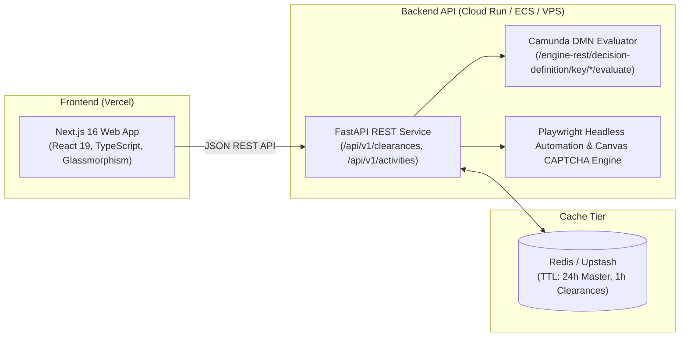

# 🌿 PARIVESH 2.0 KYA Enterprise Clearance Intelligence Suite

An executive-grade, decoupled production stack with **FastAPI Backend** and a high-performance **Next.js (React) Frontend** ready for deployment on **Vercel** and **AWS ECS / Google Cloud Run / VPS**.

Evaluates tentative clearances (Environmental, Forest, Wildlife, and Coastal Regulation Zone) from the Ministry of Environment, Forest and Climate Change (MoEFCC) **PARIVESH 2.0 KYA (Know Your Approvals)** portal.

---

## 🏛️ Enterprise Decoupled Architecture



---

## 🚀 Key Features

- **Decoupled Modern Stack:** Zero heavy browser dependencies on the frontend; instant global CDN edge delivery on **Vercel**.
- **FastAPI Backend Service:** High-throughput async REST endpoints (`/api/v1/clearances`, `/api/v1/activities`, `/api/v1/subactivities`, `/api/v1/evaluate-dmn`).
- **Zero-Click CAPTCHA Engine:** Intercepts case-sensitive CAPTCHA via canvas prototype hooks backed by dual-engine ONNX CNN recognition.
- **Camunda DMN Decision Table Evaluation:** Direct compatibility with Camunda BPM REST schema for 100% complete, un-truncated legal remarks and statutory citations.
- **Unified Redis / Upstash Caching:** Sub-50ms dropdown rendering for master sectors and 1-hour deduplication cache for identical queries.
- **Executive Glassmorphism Console:**
  - 4-metric KPI Stat Strip (Total Pillars, Applicable count, Exempt count, Toposheet Sheet No.).
  - Tentative Clearances table with glowing applicability status badges.
  - Administrative Hierarchy Breakdown (State, District, Village).
  - Proximity buffer metrics to protected areas and waterbodies.
  - Instant CSV and JSON report export.

---

## 📁 Repository Structure

```text
parivesh_scrap/
│
├── backend/                        # FastAPI REST API Service
│   ├── app/
│   │   ├── main.py                 # FastAPI app & CORS middleware
│   │   ├── config.py               # Settings (Redis, Upstash, ports)
│   │   ├── cache.py                # Unified Redis / Upstash / Memory cache
│   │   ├── schemas/                # Pydantic request/response models
│   │   ├── services/               # Clearance & DMN evaluation services
│   │   └── routers/                # REST API routers (/clearances, /activities)
│   ├── Dockerfile                  # Production container for Cloud Run / ECS
│   ├── requirements.txt            # FastAPI & Playwright dependencies
│   └── run.py                      # Local development runner
│
├── frontend/                       # Next.js 16 Client Portal (Vercel Ready)
│   ├── src/
│   │   ├── app/
│   │   │   ├── page.tsx            # Executive intelligence dashboard
│   │   │   ├── layout.tsx          # Root layout & Google typography
│   │   │   └── globals.css         # Glassmorphism design system
│   │   ├── services/api.ts         # Backend API client with fallbacks
│   │   └── types/clearance.ts      # TypeScript interfaces
│   ├── vercel.json                 # Vercel deployment configuration
│   └── package.json                # Next.js & React 19 dependencies
│
├── parivesh_engine.py              # Core headless Chromium automation & DMN intercept
├── captcha_solver.py               # Dual-engine CAPTCHA solver (ONNX + ddddocr)
├── parivesh_activities.json        # Seed catalog for 56 industrial sectors
├── start_fastapi_and_nextjs.bat    # 1-Click launcher for both services
└── start_backend.bat               # 1-Click launcher for FastAPI standalone
```

---

## 🏃 Quick Start (Local Development)

### Option 1: 1-Click Launch (Recommended)
Double-click **`start_fastapi_and_nextjs.bat`**.
This will:
1. Launch FastAPI on `http://127.0.0.1:8000` (Interactive Docs: `http://127.0.0.1:8000/docs`).
2. Launch Next.js on `http://localhost:3000`.
3. Open your browser automatically.

---

### Option 2: Manual Terminal Execution

#### 1. Start the FastAPI Backend:
```powershell
.\venv\Scripts\Activate.ps1
python backend/run.py
```

#### 2. Start the Next.js Frontend:
```powershell
cd frontend
npm run dev
```
Open [http://localhost:3000](http://localhost:3000) in your browser.

---

## ☁️ Production Deployment Guide

### A. Deploy Backend to Google Cloud Run or AWS ECS
1. Build the container from `backend/Dockerfile`:
   ```bash
   docker build -f backend/Dockerfile -t parivesh-backend:latest .
   ```
2. Set Environment Variables:
   - `UPSTASH_REDIS_REST_URL`: Your Upstash Redis REST URL (optional)
   - `UPSTASH_REDIS_REST_TOKEN`: Your Upstash Redis REST Token (optional)
   - `PORT`: `8000`
3. Deploy to Cloud Run:
   ```bash
   gcloud run deploy parivesh-kya-backend \
     --image gcr.io/YOUR_PROJECT/parivesh-backend:latest \
     --platform managed \
     --region asia-south1 \
     --allow-unauthenticated
   ```

### B. Deploy Frontend to Vercel
1. Link the `frontend/` directory to Vercel:
   ```bash
   cd frontend
   vercel
   ```
2. Set Environment Variable in Vercel Project Settings:
   - `NEXT_PUBLIC_API_URL`: Your deployed FastAPI backend URL (e.g. `https://parivesh-kya-backend-xyz.a.run.app`)
3. Deploy to production:
   ```bash
   vercel --prod
   ```

---

## 📖 API Endpoints Reference

| Method | Endpoint | Description |
| :--- | :--- | :--- |
| `GET` | `/api/v1/health` | System health and cache driver status |
| `GET` | `/api/v1/activities` | Master list of all industrial sectors (cached) |
| `GET` | `/api/v1/subactivities?activity_id={id}` | Sub-activities for specific sector (cached) |
| `POST` | `/api/v1/clearances` | Full tentative clearance evaluation |
| `POST` | `/api/v1/evaluate-dmn` | Direct Camunda DMN decision evaluation |
| `POST` | `/api/v1/cache/clear` | Invalidate Redis/in-memory cache |

Interactive Swagger documentation is available at `http://localhost:8000/docs`.
